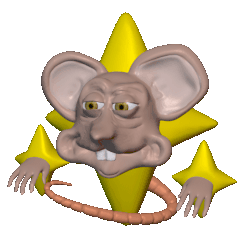

<div align="center">

# Sparkle Mouse 🐁✨
Particles! Customizable, pretty, and GPU optimized :)


<br><b>[Video (youtube)!](https://www.youtube.com/watch?v=I9LLf8ShzNA)</b><br>
[](https://www.youtube.com/watch?v=I9LLf8ShzNA)

Check out the [homepage](https://sparklemou.se).  
And the full project [github](https://github.com/max-van-leeuwen/sparkle-mouse).

<br>
<i>logo by [Livi Wilmore](https://livicg.co.uk)</i>

<br>
</div>

## Installation

```bash
npm install sparkle-mouse
yarn add sparkle-mouse
pnpm add sparkle-mouse
```

Three.js is required as a peer dependency.

## Quick Start

```javascript
import SparkleMouse from 'sparkle-mouse';

const canvas = document.getElementById('canvas');
const sparkleMouse = new SparkleMouse(canvas);

// Start with default sparkle settings
await sparkleMouse.start();
```

## Usage

### Basic Example

```javascript
import SparkleMouse from 'sparkle-mouse';

const canvas = document.getElementById('canvas');

const sparkleMouse = new SparkleMouse(canvas);


// Use default sparkles
await sparkleMouse.start();

// ...or load a .sparkle template file (URL path)
await sparkleMouse.start('/path/to/template.sparkle');

// ...or import raw .sparkle file content
import sparkleContent from './template.sparkle?raw';
await sparkleMouse.start(sparkleContent);

// ...or use custom settings object
await sparkleMouse.start({
  amount: 0.8,
  life: 0.6,
  size: 0.2,
  // ...all required settings
});
```

### Advanced

```javascript
// Disable cursor tracking and draw at screen positions
sparkleMouse.setCursorTracking(false);
sparkleMouse.drawAtScreenPosition(100, 200);
    // x: 0 to window.innerWidth
    // y: 0 to window.innerHeight

// Draw at canvas coordinates
const rect = sparkleMouse.getCanvasRect();
sparkleMouse.drawAtCanvasPosition(0, 0); // center

// Pause and resume
sparkleMouse.pause();
sparkleMouse.resume();

// Stop
await sparkleMouse.stop();

// Remove completely, e.g. when leaving the page (releases the WebGL renderer)
await sparkleMouse.destroy();

// Show demo animation
sparkleMouse.setDemoShapesDrawing(true);
sparkleMouse.setDemoShapesDrawing(true, shapes, scale); // with custom shapes and scale

// Adjust scale
sparkleMouse.setScale(1.5); // 1 = default, >1 = zoom in

// Control rendering when out of view (default is true)
sparkleMouse.setOutOfViewRendering(false);
```

## Sparkle Settings

All sparkle settings that can be passed to `start()` or used in `.sparkle` template files.

**Note:** Numerical values range from 0-1 (some use non-linear scaling).

### .sparkle File Format

A `.sparkle` file is a JSON file containing all particle settings. Here's an example:

```json
{
  "about": "Sparkle Mouse Template! 🐁✨",
  "amount": 0.48,
  "radius": 0,
  "life": 0.55,
  "size": 0.15,
  "randomize-size-lifetime": true,
  "mouse-state": "move",
  "translucent": false,
  "spinning": 0,
  "align":false,
  "turbulence": 0,
  "gravity": 0.5,
  "glide": true,
  "outwards": 0,
  "grow": true,
  "shrink": true,
  "fade": false,
  "bouncy": true,
  "glittery": true,
  "flip":false,
  "image-speed": 0,
  "image-play-from-start": false,
  "image-count": [1],
  "image-aspect-ratio": 1,
  "image-cycles": [0],
  "image-data": "image:sparkles*base64"
}
```

### Settings Reference

- **`amount`** (number, 0-1): Particle density.
- **`radius`** (number, 0-1): Spawn radius around cursor. Set to 1 for full-screen.
- **`life`** (number, 0-1): Particle lifetime.
- **`size`** (number, 0-1): Base size of particles.
- **`randomize-size-lifetime`** (boolean): Randomize size and lifetime per particle.
- **`mouse-state`** (string): When to spawn particles. Options: `"still"`, `"move"`, `"still-move"`.
- **`translucent`** (boolean): Render transparent/subtle particles.
- **`spinning`** (number, 0-1): Rotation speed of particles.
- **`align`** (boolean): Align rotation to motion (overrides spinning).
- **`turbulence`** (number, 0-1): Random chaotic motion, makes the particles feel alive.
- **`gravity`** (number, 0-1): Vertical force on particles. Default is 0.5 (center).
- **`glide`** (boolean): Sideways gliding motion on spawn.
- **`outwards`** (number, 0-1): Radial outward force on spawn.
- **`grow`** (boolean): Scale-in animation.
- **`shrink`** (boolean): Scale-out animation.
- **`fade`** (boolean): Fade-in and fade-out animation.
- **`bouncy`** (boolean): Scale-bounce animation.
- **`glittery`** (boolean): Shiny effect.
- **`flip`** (boolean): Flip texture horizontally when moving left.
- **`image-speed`** (number, 0-1): Image/GIF playback speed.
- **`image-play-from-start`** (boolean): Start image/GIF animations from first frame.
- **`image-count`** (array of numbers): Number of frames in each texture animation.
- **`image-aspect-ratio`** (number): Width/height ratio of texture images.
- **`image-cycles`** (array of numbers): Number of animation loops per texture (0 = infinite).
- **`image-data`** (string): Base64-encoded texture atlas. Can start with built-in image reference (e.g., `"image:sparkles"`) separated by asterisk (`*`). Example: `"image:sparkles*data:image/png;base64,..."`.

## API Reference

**Note:** Only the default export `SparkleMouse` is the supported public API. The package also exposes internal modules (e.g. `sparkle-mouse/helpers`, `sparkle-mouse/scene`) — these are undocumented and may change/disappear in the future. Don't depend on them.

### Constructor

```javascript
new SparkleMouse(canvas, globalScale)
```

Creates a new Sparkle Mouse instance.

**Parameters:**
- `canvas` (HTMLCanvasElement, optional): The canvas element to render on. If not provided, automatically creates and appends a full-screen canvas to the document body.
- `globalScale` (number, optional, default: 1): Global scale multiplier. >1 zooms in, <1 zooms out.

### Methods

#### `start(sparkleData)`

Starts rendering. If already running, stops and restarts with new settings. Must be awaited before calling other methods. Calls to `start()`, `stop()` and `destroy()` run one after another, even when they're not awaited.

**Parameters:**
- `sparkleData` (string|Object, optional): URL path to `.sparkle` file, raw `.sparkle` file content, settings object, or omit for default

**Returns:** Promise

```javascript
await sparkleMouse.start();
await sparkleMouse.start('/template.sparkle');

import sparkleContent from './template.sparkle?raw';
await sparkleMouse.start(sparkleContent);

await sparkleMouse.start({ amount: 0.8, life: 0.6, ... });
```

#### `getCanvas()`

Gets the canvas element used for rendering.

**Returns:** HTMLCanvasElement

```javascript
const canvas = sparkleMouse.getCanvas();
```

#### `setCursorTracking(enabled)`

Enables/disables cursor tracking (enabled by default). On mobile devices, this uses touchmove instead of mousemove.

**Parameters:**
- `enabled` (boolean): Set to false to disable.

```javascript
sparkleMouse.setCursorTracking(false);
```

#### `getCursorTracking()`

Gets the current cursor tracking state.

**Returns:** boolean - True if cursor tracking is enabled, false otherwise.

```javascript
const isTracking = sparkleMouse.getCursorTracking();
```

#### `drawAtScreenPosition(x, y)`

Draws sparkles at a specific screen position. Make sure to disable cursor tracking first!

**Parameters:**
- `x` (number, optional): X position in pixels (0 to window.innerWidth)
- `y` (number, optional): Y position in pixels (0 to window.innerHeight)

**Note:** Screen coordinates start at (0, 0) in the top-left corner. X increases to the right, Y increases downward.

Call with no arguments to interrupt the particle streak for one frame (stopping interpolation).

```javascript
// disables cursor tracking and draws particles at custom position
sparkleMouse.setCursorTracking(false);
sparkleMouse.drawAtScreenPosition(0, 0); // top-left corner
sparkleMouse.drawAtScreenPosition(100, 200);
```

```javascript
// interrupts the streak for this frame, particles drawn after this will be unconnected
sparkleMouse.drawAtScreenPosition();
```

#### `drawAtCanvasPosition(x, y)`

Draws sparkles at a specific canvas/world position. Make sure to disable cursor tracking first! Use `getCanvasRect()` to determine the current canvas coordinate bounds.

**Parameters:**
- `x` (number, optional): X position in canvas space (see `getCanvasRect()` for bounds)
- `y` (number, optional): Y position in canvas space (see `getCanvasRect()` for bounds)

Call with no arguments to interrupt the particle streak for one frame (stopping interpolation).

```javascript
// disables cursor tracking and draws particles at custom position
sparkleMouse.setCursorTracking(false);
const rect = sparkleMouse.getCanvasRect();
sparkleMouse.drawAtCanvasPosition(rect.left, rect.top); // top-left corner
```

```javascript
// interrupts the streak for this frame, particles drawn after this will be unconnected
sparkleMouse.drawAtCanvasPosition();
```

#### `getCanvasRect()`

Gets the current canvas coordinate system bounds. These bounds depend on the canvas aspect ratio and scale settings. Use these bounds with `drawAtCanvasPosition()`.

**Returns:** Object|null - Canvas bounds with properties: `left`, `right`, `top`, `bottom`, `width`, `height`. Returns null if not started.

```javascript
const rect = sparkleMouse.getCanvasRect();
// rect = { left: -0.8, right: 0.8, top: 0.5, bottom: -0.5, width: 1.6, height: 1.0 }

// Draw in center of canvas
sparkleMouse.drawAtCanvasPosition(0, 0);

// Draw at top-left corner
sparkleMouse.drawAtCanvasPosition(rect.left, rect.top);
```

#### `pause()`

Pauses rendering.

```javascript
sparkleMouse.pause();
```

#### `resume()`

Resumes rendering.

```javascript
sparkleMouse.resume();
```

#### `stop()`

Stops spawning and stops rendering sparkles.

**Returns:** Promise

```javascript
await sparkleMouse.stop();
```

#### `destroy()`

Stops rendering and releases everything this instance uses: the WebGL renderer, its listeners, and the canvas if it was created automatically. Use this when you're done with the sparkles, e.g. when removing them from the page. Create a new instance to start again.

**Returns:** Promise

```javascript
await sparkleMouse.destroy();
```

#### `setScale(scale)`

Sets the global scale. >1 zooms in, <1 zooms out.

**Parameters:**
- `scale` (number): Scale multiplier (default: 1)

```javascript
sparkleMouse.setScale(1.5);
```

#### `setOutOfViewRendering(enabled)`

Sets whether to render particles when canvas is out of view. Default is true. When false, particles won't spawn while the canvas is scrolled out of the viewport. This can save performance on pages with many sparkle instances.

**Parameters:**
- `enabled` (boolean): Set to false to disable rendering when out of view (default: true)

```javascript
sparkleMouse.setOutOfViewRendering(false);
```

#### `setDemoShapesDrawing(enabled, shapes, scale)`

Starts or stops demo shape drawing animation. Automatically disables cursor tracking.

**Parameters:**
- `enabled` (boolean): Set to true to start demo, false to stop
- `shapes` (Array, optional): Array of shape objects. Defaults to built-in shapes if not provided
- `scale` (number, optional, default: 1): Scale multiplier for shape size

```javascript
sparkleMouse.setDemoShapesDrawing(true); // start with default shapes
sparkleMouse.setDemoShapesDrawing(true, customShapes, 1.5); // custom shapes, scaled up
sparkleMouse.setDemoShapesDrawing(false); // stop
```

### Static Methods

#### `SparkleMouse.defaultSparkle`

Gets the built-in default sparkle template.

**Returns:** Object with default settings

```javascript
const defaults = SparkleMouse.defaultSparkle;
```

#### `SparkleMouse.createSparkleSettings(images, settings, downloadNow, options)`

Creates sparkle settings from images/GIF and configuration data. Returns a settings object that can be saved as a `.sparkle` file or passed to `start()`.

**Performance tip:** Generate the `.sparkle` file once and load it as a static file on start. Processing images on every page load is slow.

**Pro tip:** [Download](https://sparklemou.se/templates) more templates, or [create](https://sparklemou.se) your own!

**Parameters:**
- `images` (Array): Array of image paths or Image objects
- `settings` (Object): Configuration settings (all settings are required except for those starting with 'image-*')
- `downloadNow` (boolean, default: `false`): If true, automatically downloads the generated `.sparkle` file to disk
- `options` (Object, optional):
  - `readFile` (Function, optional): Custom `(path) => Promise<Uint8Array>` reader, for environments where `fetch()` can't reach the given paths (e.g. a desktop app reading from the native filesystem). Defaults to `fetch()`.

**Returns:** Promise<Object> - Sparkle settings object

```javascript
const sparkleSettings = await SparkleMouse.createSparkleSettings(
  ['sparkle1.png', 'sparkle2.png', 'sparkle3.gif'],
  {
    amount: 0.7,
    radius: 0.05,
    life: 0.6,
    size: 0.2,
    // ...all required settings
  },
  true // download to disk right away for later use
);
```

#### `SparkleMouse.parseSparkleFile(sparkleFileContent)`

Parses a `.sparkle` file string into a settings object.

**Parameters:**
- `sparkleFileContent` (string): The content of a `.sparkle` file as a string

**Returns:** Object - The parsed sparkle settings object

**Throws:** SyntaxError if the file content is not valid JSON after processing

```javascript
import sparkleContent from './mysparkle.sparkle?raw';
const settings = SparkleMouse.parseSparkleFile(sparkleContent);
await sparkleMouse.start(settings);
```

### Properties

- `isStarted` (boolean, readonly): Whether rendering has been started
- `isPaused` (boolean, readonly): Whether rendering is currently paused

## License

MIT

## Support
If you like this project and want to support it, please consider buying the [executable](https://maxvanleeuwen.itch.io/sparkle-mouse) or [donating](https://ko-fi.com/maxvanleeuwen)! :)